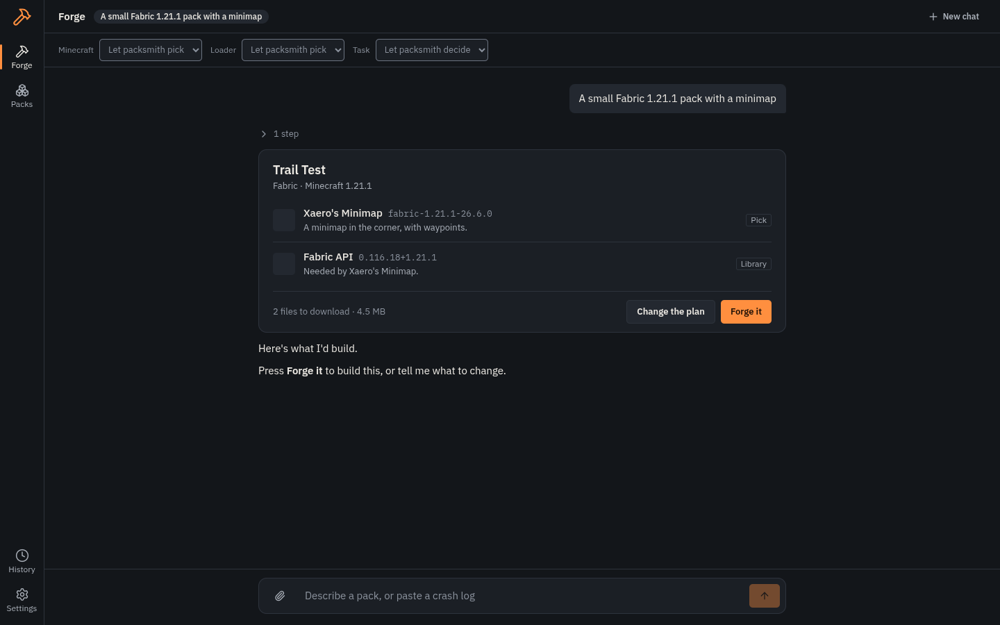
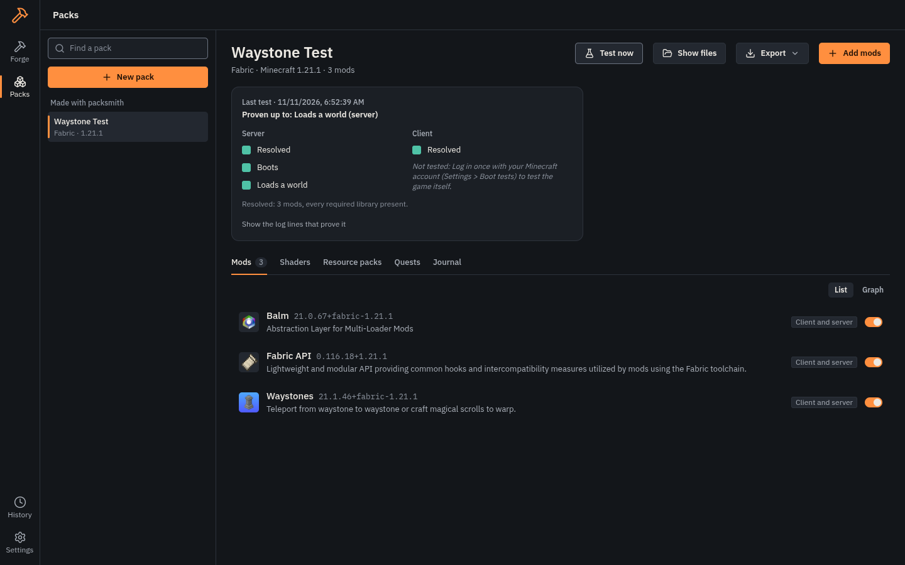
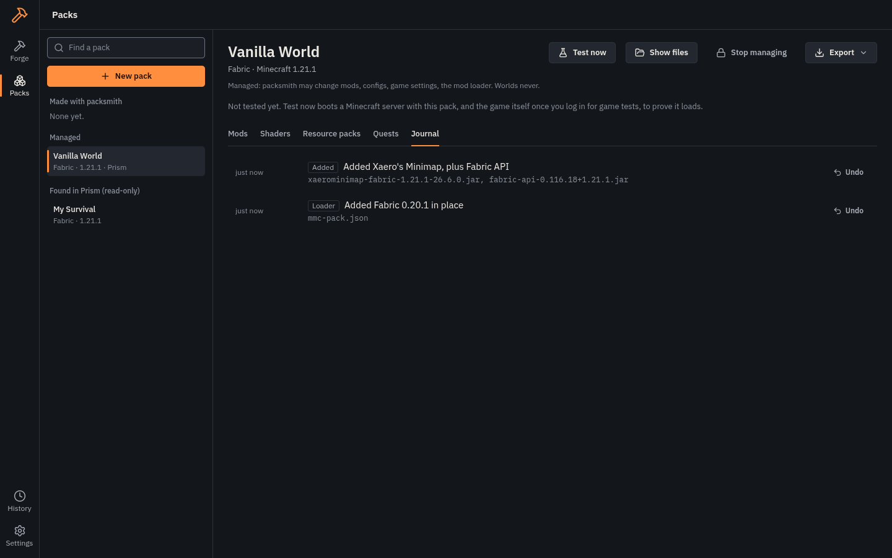
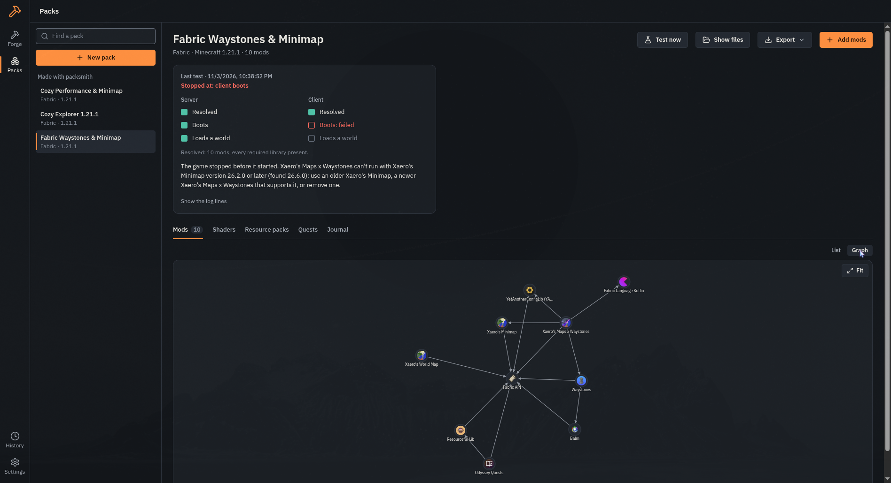

<p align="center">
  
</p>

<h1 align="center">packsmith</h1>

<p align="center">
  <b>Describe a Minecraft modpack. packsmith builds it, boots it, and fixes it until it loads.</b><br>
  Free and open source. Bring your own AI key: there is nothing to pay packsmith, ever.
</p>

<p align="center">
  <a href="#install">Install</a> ·
  <a href="#what-it-does">What it does</a> ·
  <a href="#how-it-stays-safe">Safety</a> ·
  <a href="#develop">Develop</a>
</p>

<p align="center">
  
</p>

## Why

Putting a modpack together means hunting for versions that match, finding every library each mod
needs, then launching the game to find out what crashes, and repeating. packsmith does that loop for
you with an AI agent, and it doesn't stop at "files written": it **starts a real Minecraft server and
the real game on a hidden screen** and shows you exactly how far the pack got, with the log lines
that prove it.

## What it does

- **Builds packs from a sentence.** "A cozy Fabric 1.21.1 pack with a minimap" becomes a plan card
  (each pick with a reason, every library it needs, the download size). Press **Forge it** and the
  agent builds it while a live feed shows every step.
- **Resolves dependencies** from Modrinth's metadata: required libraries come along, conflicts and
  missing versions are explained with a fix. Every file is checked against Modrinth's SHA-1 and
  SHA-512 before it's installed.
- **Proves the pack boots.** The evidence ladder shows, per branch, *Resolved → Boots → Loads a
  world*, for a dedicated server and for the game itself (with your own Minecraft login, run
  headlessly). It never claims a rung it didn't see in the log.
- **Fixes crashes.** It reads the failure, names the cause (a missing library, a mod for another
  version, two mods that refuse each other, and which versions every mod would accept), repairs the
  pack, and tests again.
- **Manages your existing Prism instances**, only if you ask: they're listed read-only until you
  choose *Manage* and tick what packsmith may change (mods, configs, settings, shaders, resource
  packs, quests, or a loader on a vanilla instance). Worlds are never touched.
- **Every change can be undone** from the pack's Journal, file for file.
- **Quests**: writes quest lines (Heracles, or vanilla advancements that need no mods), checking every
  item and mob against what's actually in the pack. Shows FTB Quests books that came with a pack.
- **Exports** as `.mrpack` (for Prism, the Modrinth App and others) or as a Prism instance folder,
  with a licence list; files that aren't on Modrinth are listed, never bundled.
- **Web search** for mod docs and known conflicts (optional, with a free Tavily key).
- **Dependency graph** of a pack, with *why is this here* for every mod.

<p align="center">
  
</p>

## Install

**Linux** (x86-64). Grab `packsmith-<version>-x86_64.AppImage` from
[Releases](https://github.com/Malekabokhatwa/packsmith/releases), then either run it directly:

```sh
chmod +x packsmith-*.AppImage && ./packsmith-*.AppImage
```

or install it into your app launcher (no root needed; run it again to update):

```sh
git clone https://github.com/Malekabokhatwa/packsmith && cd packsmith
scripts/install-linux.sh ~/Downloads/packsmith-*.AppImage   # --uninstall removes it
```

### First run

1. **Settings → AI provider**: paste a key. Google Gemini's free tier works without a card
   ([get a key](https://aistudio.google.com/apikey)); DeepSeek, OpenRouter, OpenAI, Anthropic and local
   models (Ollama, LM Studio) work too. Each option says what it costs before you connect it. Keys go
   to your system keyring, never to a file.
2. Optional: **Settings → Web search** with a free [Tavily](https://app.tavily.com) key.
3. For boot tests: accept Minecraft's EULA once, and log in with your own Minecraft account for the
   game test (Settings → Boot tests).
4. Describe a pack.

Packs go into packsmith's own folder, or into [Prism Launcher](https://prismlauncher.org) in a
"packsmith" group if you choose that in Settings.

## How it stays safe

- packsmith only changes packs it made (they carry a `.packsmith-instance.json` marker) and instances
  you explicitly chose to manage, and only within what you allowed. A decoy instance in its test
  suite must stay identical byte for byte.
- Every change is journaled with a backup before it happens; a change cut off by a crash is rolled back
  on the next start.
- All network traffic goes through one guarded client: HTTPS only, no private or metadata addresses,
  size and time limits. Mods download from Modrinth's CDN only, hash-checked.
- Web pages, logs and mod descriptions are handed to the model as data, clearly marked, never as
  instructions.
- **Mods are other people's code.** Minecraft mods run as Java with your user's full permissions,
  including network access. packsmith checks what it downloads and writes; it doesn't sandbox mods
  once Minecraft runs them.

<p align="center">
  
</p>

## Develop

Node 22+ and npm. Electron, TypeScript, React, Tailwind, zod.

```sh
npm install
npm run dev         # the app with hot reload
npm test            # unit tests (no network, no AI calls)
npm run e2e         # builds, then drives the real app on a virtual display (needs xvfb-run and network)
npm run typecheck
npm run dist        # builds the AppImage into dist/
```

Tests never call a real AI provider: a scripted model drives the agent. Boot tests in the e2e suite
start a real Minecraft server in a scratch folder.

## Status

Linux first; Prism Launcher and packsmith's own folder (the official Minecraft Launcher comes later).
Fabric, NeoForge and Forge packs; the game test is proven for Fabric and NeoForge. Modrinth content
only. Gameplay itself is never claimed: "loads a world" is the highest rung.

<p align="center">
  
</p>

## Licence

[MIT](LICENSE). Minecraft is a trademark of Mojang AB; packsmith isn't affiliated with Mojang or
Microsoft.
